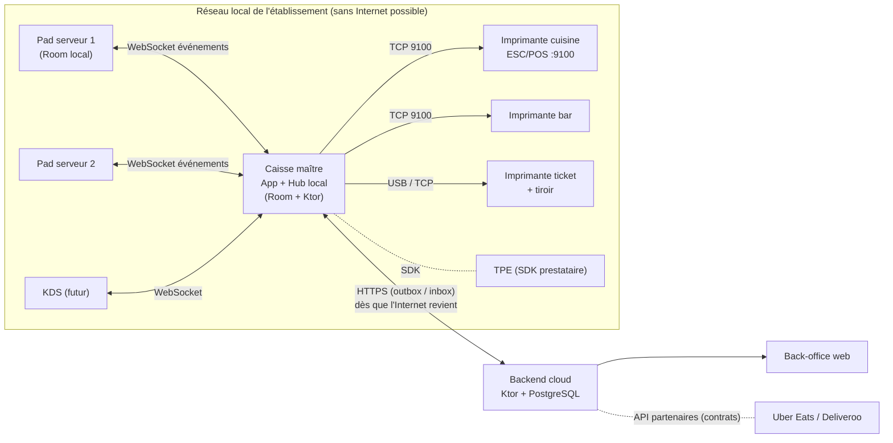

# B. Architecture technique et flux offline / local / cloud

## 1. Choix technologiques

| Couche | Choix | Justification | Alternative écartée |
|--------|-------|---------------|---------------------|
| App caisse | **Kotlin + Jetpack Compose**, minSdk 24, targetSdk 35 | Natif, performant sur matériel modeste, accès direct USB/Bluetooth/NSD, SDK fabricants (Sunmi, iMin, PAX) en Java/Kotlin. | Flutter / React Native : ponts natifs obligatoires pour chaque SDK matériel, débogage d'impression plus difficile. |
| Domaine métier | **Module Kotlin/JVM pur `:core`** sans dépendance Android | Testable en CI en secondes ; réutilisable côté hub, backend (Ktor) et KDS. | Logique dans les ViewModels : non testable, dupliquée. |
| Persistance locale | **Room (SQLite)**, WAL, triggers SQL anti-UPDATE/DELETE sur les tables fiscales | Transactions ACID, migrations versionnées ; les triggers rendent l'append-only vérifiable au niveau base. | Realm / ObjectBox : moins de contrôle SQL, triggers impossibles. |
| Hub local | **Ktor server embarqué** (HTTP + WebSocket) sur la caisse maître, découverte **mDNS/NSD** | Fonctionne sur LAN sans Internet ; même langage que `:core`. | MQTT broker : un composant de plus à opérer. |
| Backend cloud | **Kotlin + Ktor + PostgreSQL**, files d'événements (outbox → table d'ingestion idempotente) | Réutilise `:core` ; PostgreSQL pour contraintes, RLS par établissement. | Firebase : modèle de droits et conservation fiscale mal adaptés. |
| Back-office | **SPA TypeScript (React)** responsive, API REST/JSON | Écosystème mature pour tableaux de bord. | Kotlin/JS : écosystème plus pauvre. |
| Impression | **ESC/POS** brut (TCP 9100, USB host, Bluetooth SPP) derrière une interface `PrinterDriver` ; drivers SDK fabricants en plugins | ESC/POS couvre ~90 % des imprimantes thermiques. | — |
| Crypto fiscale | **SHA-256 chaîné + signature ECDSA P-256**, clé dans **Android Keystore** (non exportable) | Standard, accéléré matériellement, vérifiable par un tiers avec la clé publique. | HMAC seul : clé secrète partagée, non vérifiable par un tiers. |

## 2. Découpage en modules (Gradle)

```
foodsafe-pos/
├── core/        Kotlin/JVM pur : argent, TVA, remises, commandes, niveaux, envois cuisine,
│                divisions, attribution espèces, journal chaîné, signature (✅ incrément 1)
├── app/         Android : Compose UI, Room, ViewModels, câblage (✅ incrément 1, minimal)
├── hardware/    (à venir) PrinterDriver, ESC/POS encoder, CashDrawer, Scanner, PaymentTerminal
├── hub/         (à venir) serveur local Ktor, protocole d'événements, verrous de table
├── sync/        (à venir) outbox, client cloud, réconciliation
├── backend/     (à venir) API cloud Ktor + PostgreSQL
└── backoffice/  (à venir) SPA web
```

Règle de dépendance : `app → hardware, hub, sync → core`. `core` ne dépend de rien (sauf la bibliothèque standard Kotlin).

## 3. Séparation des flux métier (exigence explicite)

Six familles d'objets **distinctes**, jamais fusionnées :

| Famille | Exemple | Mutable ? | Stockage |
|---------|---------|-----------|----------|
| **État de commande** | Table 43 ouverte, 3 lignes, N1 réclamé | Oui (projection) | `orders`, `order_lines` (reconstructibles depuis les événements) |
| **Événement de paiement** | 20 € espèces reçus sur la commande X par Marie | Non | `payments` (append-only) |
| **Mouvement de fonds** | +20 € dans tiroir T1 ; −50 € remise coffre | Non | `cash_movements` (append-only) |
| **Document fiscal** | Ticket n° T01-000123, Z n° 45 | Non | `fiscal_documents` (append-only, chaîné, signé) |
| **Événement d'impression** | Job 77 → imprimante Cuisine : envoyé, statut incertain | Statut évolue par événements | `print_jobs` + `print_job_events` |
| **Événement de synchronisation** | Lot 12 accusé par le hub | Non | `sync_outbox`, `sync_inbox` |

Le **journal d'audit** (`journal_events`) trace en plus chaque opération sensible : identifiant immuable (UUID v4), acteur, terminal, horodatage, type, avant/après (JSON), motif, hash précédent, hash courant.

## 4. Topologie



## 5. Principes de cohérence

1. **Chaque terminal est souverain pour ses documents fiscaux.** Il possède sa propre séquence (`T01-000001…`), sa chaîne de hash et sa clé de signature. Il peut encaisser même si le hub et le cloud sont injoignables. Le Z d'établissement agrège les Z terminaux sans double comptage (clé : identifiant de document).
2. **Le hub est l'autorité de coordination des commandes partagées** (tables). Il attribue un numéro de version à chaque commande ; un terminal qui modifie une table envoie `(orderId, expectedVersion, commande)` ; un conflit de version renvoie l'état courant et l'UI rejoue l'action ou informe.
3. **Idempotence partout.** Chaque commande métier porte un `idempotencyKey` (UUID généré au tap). Le hub et le cloud stockent les clés traitées ; une répétition retourne le résultat initial. C'est ce qui empêche le double envoi cuisine ou le double paiement après une coupure réseau.
4. **Envoi cuisine : marquage atomique.** Les lignes envoyées reçoivent `dispatchId` dans la même transaction que la création du bon d'impression. Une ligne avec `dispatchId` n'est **jamais** reprise par un envoi ultérieur (testé dans `KitchenDispatcherTest`).
5. **Événements sync = outbox transactionnelle.** Toute écriture métier insère dans `sync_outbox` dans la même transaction SQLite. Un worker pousse au hub puis au cloud, avec accusé et reprise exponentielle.
6. **Horloge.** Horodatages en UTC + fuseau de l'établissement. Le hub diffuse son heure ; un écart > 2 min déclenche une alerte (impact sur les clôtures). L'ordre fiscal repose sur la séquence, pas sur l'horloge.

## 6. Flux principaux

### 6.1 Prise de commande et envoi cuisine (multi-terminal)

```mermaid
sequenceDiagram
  participant Pad
  participant Hub
  participant Imp as Imprimante cuisine
  Pad->>Hub: AddLines(order, v=3, key=K1)
  Hub-->>Pad: OK v=4
  Pad->>Hub: SendToKitchen(order, v=4, key=K2)
  Hub->>Hub: tx { lignes sans dispatchId → dispatch D1 ; print_job J1 (PENDING) }
  Hub-->>Pad: OK v=5, dispatch D1
  Hub->>Imp: ESC/POS job J1
  Imp-->>Hub: ACK TCP (≠ impression confirmée)
  Hub->>Hub: J1 = SENT_UNCONFIRMED ou PRINTED si statut DLE EOT OK
  Note over Pad,Hub: Si Pad renvoie K2 après coupure → Hub renvoie D1, ne recrée rien
```

### 6.2 Encaissement et documents fiscaux

1. Pad/caisse : `RecordPayment(order, amount, method, key)` → `payments` + `cash_movements` (si espèces, vers le fond déterminé par la règle d'attribution) + `journal_events`.
2. Solde nul → `FiscalDocument(TICKET)` : numéro suivant de la séquence du terminal, contenu canonique, `prevHash`, `hash = SHA-256(prevHash ‖ contenu canonique)`, `signature = ECDSA(hash)`, totaux perpétuels mis à jour (grand total perpétuel, cumul perpétuel par taux).
3. Impression du ticket (auto/manuelle) = `print_job` lié ; une réimpression produit un **duplicata** marqué, journalisé.

### 6.3 Catalogue (cloud → terminaux)

Back-office → version catalogue `n+1` (diff signé par le serveur) → cloud → hub → terminaux. Application atomique ; toast discret « Mise à jour catalogue reçue » 3 s. Une commande en cours garde le prix figé de sa ligne (copie du prix dans `order_lines`).

## 7. Cas de panne

| Panne | Comportement attendu | Ce qui ne marche plus |
|-------|----------------------|-----------------------|
| **Coupure Internet** | Tout le LAN fonctionne. Outbox s'accumule ; back-office affiche « données au JJ/MM HH:MM ». | TPE en ligne (selon prestataire), plateformes livraison, consommation d'avoir multi-sites, MAJ catalogue. |
| **Panne routeur local** | Chaque terminal bascule en **mode autonome** : il peut encaisser ses propres notes et imprimer en USB/Bluetooth local. Les tables partagées sont verrouillées en lecture sur les terminaux non-maîtres (on n'invente pas d'état). | Impression réseau, partage des tables. |
| **Hub indisponible** (caisse maître éteinte) | Pads en mode autonome comme ci-dessus ; procédure de **promotion manuelle** d'un autre terminal en hub (PIN admin), qui reprend depuis le dernier état répliqué. | Coordination tant que non promu. |
| **Appareil redémarré** | État reconstruit depuis Room ; outbox reprise ; jobs d'impression `PENDING` relancés, `SENT_UNCONFIRMED` signalés à l'utilisateur (pas relancés automatiquement). | — |
| **Imprimante en panne** | Bascule chaîne de secours ; bon marqué « DESTINATION : CUISINE » ; retour auto à la principale avec notification discrète. | — |
| **Impression incertaine** | Statut `SENT_UNCONFIRMED`, bandeau orange, action « Réimprimer (marqué DUPLICATA) » à la main. | — |
| **Paiements concurrents** sur la même note | Le hub sérialise par `orderId` ; un paiement dépassant le reste dû est refusé (sauf rendu espèces explicite). | — |
| **Avoir consommé sur deux sites hors ligne** | Politique par défaut : **un avoir enseigne n'est utilisable hors ligne que sur le site émetteur** ; sinon consommation refusée sans réponse du cloud. | Avoir multi-sites hors ligne. |

## 8. Sécurité

- Base Room chiffrée (SQLCipher) en phase 2 ; clé enveloppée par Android Keystore.
- Clé de signature fiscale ECDSA générée dans Keystore, jamais exportée ; clé publique enregistrée au cloud lors de l'appairage du terminal.
- Appairage terminal ↔ établissement par QR à usage unique ; jetons d'appareil révocables ; TLS (certificat épinglé) vers le cloud, TLS local hub avec certificat auto-signé distribué à l'appairage.
- Droits vérifiés **côté hub et côté cloud**, pas seulement dans l'UI.
- Aucune donnée de carte (PAN, piste) ne transite par l'app : seul le résultat du TPE (montant, référence d'autorisation masquée) est stocké.
- RGPD : données clients (livraison, avoirs par email) minimisées, purge paramétrable, séparation stricte par `establishmentId` (RLS PostgreSQL côté cloud).

## G — État de cette étape

- **Fonctionne :** module `:core` (cf. F) implémente les principes 3 (idempotence de l'envoi cuisine), 4 et la chaîne de hash/signature de §6.2 ; module `:app` compile en APK avec Room + triggers append-only.
- **Simulé :** la clé de signature est logicielle dans les tests (pas encore Android Keystore).
- **À faire :** hub Ktor, outbox, HAL imprimante, backend, back-office.
- **Risques :** performance du hub sur caisses bas de gamme (à mesurer) ; mDNS parfois filtré par les routeurs grand public (prévoir IP manuelle) ; bascule de hub = point délicat à concevoir avec l'organisme certificateur.
