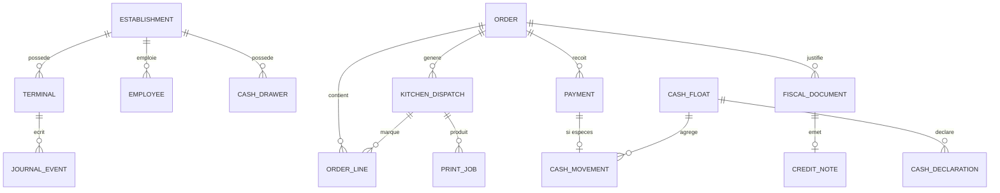

# C. Modèle de données

Conventions : identifiants `TEXT` UUID v4 (générés sur le terminal, donc sans collision hors ligne) ; montants `INTEGER` en **centimes** ; taux en **points de base** (`1000` = 10,00 %) ; quantités en **millièmes** (`1000` = 1 unité, permet 0,5 kg) ; horodatages `INTEGER` epoch ms UTC. Toute table porte `establishment_id`. Les tables marquées 🔒 sont **append-only** (triggers `BEFORE UPDATE/DELETE → RAISE(ABORT)`).

Le sous-ensemble implémenté dans l'incrément 1 est marqué ✅ (voir `app/src/main/java/.../data/` et `core/src/main/resources/schema/journal.sql`).

## 1. Organisation et configuration

| Table | Colonnes clés | Notes |
|-------|---------------|-------|
| `brands` (enseigne) | id, name, settings_json | Paramètres par défaut hérités. |
| `establishments` | id, brand_id, name, siret, vat_number, address, timezone, settings_json, cash_management_enabled | `settings_json` surcharge l'enseigne (héritage par clé). |
| `terminals` | id, establishment_id, code (`T01`), kind (`FIXED`/`PAD`/`KDS`/`KIOSK`), default_drawer_id, public_key, paired_at, revoked_at | `code` préfixe la numérotation fiscale. |
| `cash_drawers` | id, establishment_id, name, physical_printer_id | Tiroir **physique** ; plusieurs terminaux peuvent le partager. |
| `sale_modes` | id, establishment_id, kind (`DINE_IN`/`TAKEAWAY`/`DELIVERY`), auto_send_on_hold, auto_send_on_pay, auto_print_receipt, notes_visibility (`SHARED`/`OWNER_ONLY`), receipt_template_id | Config par mode. |

## 2. Personnes et droits

| Table | Colonnes clés |
|-------|---------------|
| `employees` | id, establishment_id, display_name, role_id, active, has_personal_float (banane) |
| `credentials` | id, employee_id, kind (`PIN`/`DALLAS`/`RFID`/`BARCODE`/`BIOMETRIC`), secret_hash (PBKDF2/Argon2 pour PIN), token_hash, active |
| `roles` | id, establishment_id, name (`SERVER`/`MANAGER`/`ADMIN`/custom) |
| `permissions` | role_id, action (ex. `DISCOUNT_LINE_PERCENT`, `REFUND`, `CANCEL_SENT_LINE`), policy (`FREE`/`LIMITED`/`MANAGER_PIN`/`ALWAYS_VALIDATE`/`FORBIDDEN`), limit_value |
| `sessions` | id, employee_id, terminal_id, opened_at, closed_at, close_reason (`LOGOUT`/`INACTIVITY`) |

## 3. Salles et commandes

| Table | Colonnes clés | Notes |
|-------|---------------|-------|
| `rooms` | id, establishment_id, name, layout_json | |
| `tables` | id, room_id, number, seats, x, y, shape | `number` modifiable (43 → 56) ; historique dans le journal. |
| ✅ `orders` | id, establishment_id, terminal_id, sale_mode, table_number, owner_employee_id, status (`OPEN`/`ON_HOLD`/`PAID`/`CANCELLED`), version, opened_at, closed_at, parent_order_id (séparation), covers | `version` = verrou optimiste. |
| ✅ `order_lines` | id, order_id, product_id, label, unit_price_ttc, quantity_milli, vat_rate_bp, service_level (0 = direct, 1..n), line_discount_kind, line_discount_value, author_employee_id, created_at, dispatch_id, cancelled_at, cancel_reason, cancelled_by | Prix et taux **figés** à l'ajout. |
| `order_level_claims` | order_id, level, claimed_at, claimed_by | « Réclamer N1… » |
| ✅ `kitchen_dispatches` | id, order_id, kind (`INITIAL`/`ADDITION`/`CLAIM`/`CANCELLATION`/`TABLE_MOVE`), level, created_at, created_by, idempotency_key UNIQUE | Un bon = un dispatch ; la clé unique empêche les doublons. |
| `order_transfers` 🔒 | id, order_id, from_employee, to_employee, by_employee, at, batch_id | Transferts unitaires ou en masse. |

## 4. Catalogue et promotions

| Table | Colonnes clés |
|-------|---------------|
| `catalog_versions` | id, establishment_id, version, published_at, published_by, signature |
| `families` | id, name, default_destination_id, default_service_level |
| `products` | id, family_id, name, price_ttc, vat_rate_bp_dine_in, vat_rate_bp_takeaway, default_service_level, destination_id, active, unavailable_until |
| `promotions` | id, establishment_id, kind (`BUY_X_GET_Y`/`PERCENT`/`FIXED_PRICE`), scope_json, schedule_json (jours, heures, période), cumulable, priority, free_item_rule (`CHEAPEST`/`MOST_EXPENSIVE`/`PRESET`/`SELLER_CHOICE`), repeat (bool) |
| `applied_discounts` 🔒 | id, order_id, line_id (NULL = ticket), kind (`PERCENT`/`AMOUNT`), value, promotion_id, applied_by, approved_by, reason, at | Ticket ⇒ `PERCENT` uniquement (contrainte CHECK). |

## 5. Paiements, fonds, clôtures

| Table | Colonnes clés | Notes |
|-------|---------------|-------|
| `payments` 🔒 | id, order_id, split_part_id, method (`CASH`/`CARD`/`MEAL_VOUCHER`/`CREDIT_NOTE`…), amount, tendered, change_given, cashier_employee_id, terminal_id, float_id, tpe_reference, at, idempotency_key UNIQUE | Paiement attribué à l'encaissant ET au fond. |
| `split_parts` | id, order_id, mode (`EQUAL`/`AMOUNT`/`ITEMS`), index, amount_due, status | Pour « Diviser le reste ». |
| `cash_floats` | id, kind (`DRAWER`/`PERSONAL`), drawer_id, employee_id, opened_at, opened_by, opening_amount, closed_at, status (`OPEN`/`CLOSED`) | Un fond clôturé est verrouillé. |
| `cash_movements` 🔒 | id, float_id, kind (`OPENING`/`SALE_CASH`/`CHANGE`/`IN`/`OUT`/`TO_SAFE`/`HANDOVER_OUT`/`HANDOVER_IN`/`REFUND_CASH`), amount (signé), payment_id, actor, reason, at | Un paiement carte ne crée **aucun** mouvement. |
| `cash_declarations` 🔒 | id, float_id, stage (`THEORETICAL`/`DECLARED_BY_SERVER`/`RECEIVED_BY_MANAGER`/`CORRECTION`), amount, count_mode (`TOTAL`/`DENOMINATIONS`/`NO_RECOUNT`), denominations_json, blind (bool), actor, at, comment | Déclarations successives jamais modifiées (225 / 236 / 225). |
| `closures` 🔒 | id, kind (`X`/`Z_TERMINAL`/`Z_ESTABLISHMENT`/`MONTH`/`YEAR`), terminal_id, period_start, period_end, totals_json, perpetual_grand_total, fiscal_document_id | X non fiscal (ne remet rien à zéro), Z fiscal. |

## 6. Documents fiscaux et avoirs

| Table | Colonnes clés | Notes |
|-------|---------------|-------|
| `fiscal_documents` 🔒 | id, terminal_id, doc_type (`TICKET`/`NOTE`/`REFUND`/`CREDIT_NOTE`/`Z`/`DUPLICATE`), number (séquence continue par terminal et type), order_id, related_document_id, canonical_content, total_ttc, totals_by_rate_json, perpetual_total, perpetual_total_abs, prev_hash, hash, signature, key_id, at | Base de l'inaltérabilité. |
| `credit_notes` | id, number, fiscal_document_id, amount_initial, scope (`STORE`/`BRAND`), valid_until, issuing_establishment_id | Solde = initial − Σ consommations. |
| `credit_note_uses` 🔒 | id, credit_note_id, payment_id, amount, establishment_id, at, authorization_ref (cloud) | Autorisation cloud requise si portée enseigne. |

## 7. Impressions et synchronisation

| Table | Colonnes clés |
|-------|---------------|
| `printers` | id, name, connection (`TCP`/`USB`/`BT`), address, paper_width (58/80), supports_inverse, kind (`RECEIPT`/`KITCHEN`/`BAR`), backup_printer_id |
| `print_routes` | product_id / family_id → destination_id ; destination_id → printer_id ; mode (`FULL_WITH_LEVELS`/`IMMEDIATE_ONLY`/`PER_LEVEL`), claim_ticket_style (`SHORT`/`DETAILED`) |
| `print_jobs` | id, dispatch_id / fiscal_document_id, destination_id, target_printer_id, payload_escpos BLOB, status (`PENDING`/`SENDING`/`SENT_UNCONFIRMED`/`PRINTED`/`FAILED`/`REROUTED`), attempts, created_at |
| `print_job_events` 🔒 | id, job_id, event, printer_id, detail, at |
| `sync_outbox` | seq, event_id, payload, created_at, pushed_at, acked_at |
| `sync_inbox` | event_id PRIMARY KEY, source_terminal, received_at | Clé primaire = déduplication. |

## 8. Journal d'audit ✅ 🔒

`journal_events(seq INTEGER PK, id TEXT UNIQUE, establishment_id, terminal_id, actor_id, occurred_at, type, entity_type, entity_id, before_json, after_json, reason, prev_hash, hash)`

- `hash = SHA-256(prev_hash | seq | id | … | reason)` sur une **sérialisation canonique** (`core/.../journal/CanonicalEncoder.kt`).
- Premier maillon : `prev_hash = "GENESIS"` + identifiant terminal.
- Vérification : `JournalVerifier` recalcule toute la chaîne et signale le premier maillon rompu.
- Triggers `journal_no_update` et `journal_no_delete` (testés en JVM avec SQLite réel).

## 9. Diagramme simplifié

## G — État de cette étape

- **Fonctionne :** `orders`, `order_lines`, `kitchen_dispatches`, `journal_events` (Room + triggers append-only) dans l'incrément 1.
- **À faire :** toutes les autres tables ; migrations Room versionnées ; schéma PostgreSQL miroir côté cloud.
- **Risques :** le format exact du contenu canonique et des totaux perpétuels doit être aligné sur le référentiel de l'organisme certificateur **avant** la première mise en production, sinon migration d'archives délicate.
